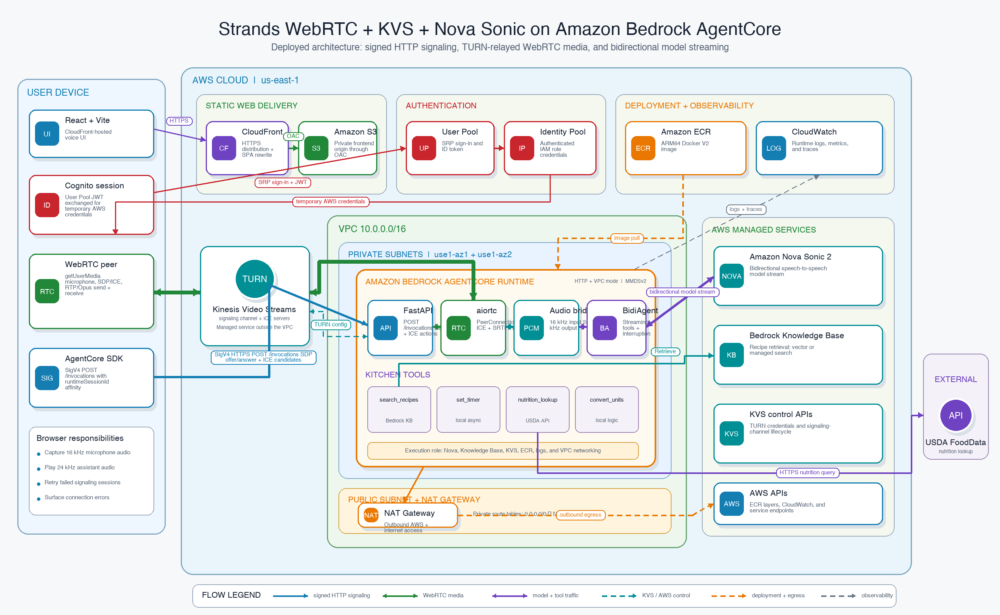

# Strands BidiAgent + Nova Sonic on AgentCore

## Notice
The code is for PoC or test staging purpose, please verify and evaluate before deploying to production

A real-time voice recipe assistant built with **Strands BidiAgent**, **Amazon Nova Sonic 2**, **WebRTC**, and **Amazon Bedrock AgentCore Runtime**. The browser streams microphone audio to the agent and receives synthesized speech over the same peer connection.

This sample extends [`psantus/strands-bidir-nova`](https://github.com/psantus/strands-bidir-nova) with deployment and reliability updates for AgentCore VPC mode, and is published under `samples/bidi-streaming/strands-webrtc-kvs-sonic` in this repository.

## Features

- Voice conversation with interruption (barge-in)
- Recipe search through an Amazon Bedrock Knowledge Base
- Nutrition lookup through USDA FoodData Central
- Cooking timers and unit conversion tools
- Local peer-to-peer WebRTC development
- Deployed WebRTC through Kinesis Video Streams (KVS) TURN
- Cognito authentication and temporary browser AWS credentials
- Terraform-managed VPC, AgentCore, ECR, Cognito, S3, and CloudFront

## Architecture



### Control plane: HTTP signaling

The browser uses the AgentCore JavaScript SDK with Cognito temporary credentials to sign calls to the runtime's `/invocations` endpoint. These calls carry:

1. KVS TURN configuration (`ice_config`)
2. The browser SDP offer (`offer`)
3. Trickle ICE candidates (`ice_candidate`)
4. Session cleanup (`disconnect`)

The same AgentCore `runtimeSessionId` is reused so all signaling calls reach the runtime process holding the in-memory `RTCPeerConnection`.

### Media plane: WebRTC audio

KVS supplies TURN credentials and relays encrypted WebRTC traffic. It does not invoke the model or transform audio.

```text
Browser microphone
  -> WebRTC RTP/Opus through KVS TURN
  -> aiortc MediaStreamTrack
  -> WebRTCBidiInput (16 kHz, mono, PCM, base64)
  -> Strands BidiAgent
  -> BidiNovaSonicModel
  -> Amazon Nova Sonic 2

Amazon Nova Sonic 2
  -> bidi_audio_stream (24 kHz PCM, base64)
  -> WebRTCBidiOutput
  -> OutputTrack (20 ms frames through av.AudioFifo)
  -> aiortc WebRTC RTP/Opus
  -> browser speakers
```

`BidiAgent` orchestrates the Nova stream, tool calls, and interruption events. `aiortc` owns SDP, ICE, DTLS/SRTP, RTP/RTCP, codecs, and media tracks. The adapters in `src/webrtc_io.py` bridge the two systems.

### Deployed mode

- AgentCore Runtime runs the ARM64 container in two private subnets.
- A NAT gateway provides ECR, Bedrock, KVS TURN, CloudWatch, and external API egress.
- Physical Availability Zone IDs are used because AgentCore supports specific AZ IDs, while AZ names vary by AWS account.
- The browser is hosted by CloudFront/S3 and signs AgentCore calls with Cognito identity credentials.
- Terraform enforces AgentCore MMDSv2 after runtime creation and image updates.

### Local mode

The Vite development server proxies `/invocations` to FastAPI. WebRTC connects directly on localhost without KVS TURN or Cognito.

## Prerequisites

- macOS or Linux
- Python 3.13+
- [`uv`](https://docs.astral.sh/uv/getting-started/installation/)
- Node.js 18+
- Terraform 1.5+
- AWS CLI v2
- Docker Desktop or another Docker engine with ARM64/buildx support
- An AWS CLI profile with permissions for AgentCore, IAM, VPC, ECR, Cognito, S3, CloudFront, Bedrock, KVS, and CloudWatch Logs
- Nova Sonic 2 model access in the deployment region
- An existing Bedrock Knowledge Base

For local `aiortc`/PyAV builds when a wheel is unavailable:

```bash
# macOS
brew install ffmpeg opus libvpx pkg-config

# Ubuntu/Debian
sudo apt install libavdevice-dev libopus-dev libvpx-dev pkg-config
```

## Clone and install

```bash
git clone https://github.com/ddynwzh1992/sample-voice-agent-on-aws.git
cd sample-voice-agent-on-aws/samples/bidi-streaming/strands-webrtc-kvs-sonic

uv sync
cd frontend && npm install && cd ..
```

The Bedrock bidirectional SDK is intentionally pinned to `aws-sdk-bedrock-runtime==0.7.0`. Strands 1.28 uses the synchronous `BedrockRuntimeClient`; newer pre-1.0 SDK releases renamed that client and prevent the container from starting.

## Run locally

Configure an AWS profile that can invoke Nova Sonic and retrieve from the Knowledge Base:

```bash
export AWS_PROFILE=default
export AWS_REGION=us-east-1
export BEDROCK_KB_ID=YOUR_KB_ID
```

Start the backend and frontend in separate terminals:

```bash
make serve AWS_PROFILE="$AWS_PROFILE"
make serve-frontend
```

Open <http://localhost:5173>, allow microphone access, and select the microphone button.

## Deploy to AWS

### 1. Configure Terraform

```bash
cp infrastructure/terraform.tfvars.example infrastructure/terraform.tfvars
```

Set at least:

```hcl
aws_region           = "us-east-1"
availability_zone_ids = ["use1-az1", "use1-az2"]
knowledge_base_id    = "YOUR_KB_ID"

cognito_users = {
  "user@example.com" = "A-Strong-Temporary-Password1"
}
```

Use AgentCore-supported physical AZ IDs for the selected region. `infrastructure/terraform.tfvars` is ignored by Git; do not commit passwords or local Terraform state.

### 2. Initialize, plan, and apply

```bash
terraform -chdir=infrastructure init
make plan AWS_PROFILE=default
make apply AWS_PROFILE=default
```

The Make targets pass the selected profile as a Terraform CLI variable, which overrides `terraform.tfvars` and keeps the AWS provider and apply-time AWS CLI/Python provisioners on the same account.

A single apply creates or updates:

- VPC, public/private subnets, internet gateway, NAT gateway, routes, and security group
- ECR repository and ARM64 container image
- AgentCore execution role and VPC-mode HTTP runtime
- AgentCore MMDSv2 metadata configuration
- Cognito user pool, identity pool, users, and authenticated role
- S3 frontend bucket and CloudFront distribution
- Generated frontend environment, production build, S3 sync, and CloudFront invalidation

The KVS signaling channel is created lazily on the first `ice_config` invocation.

### 3. Open the application

```bash
terraform -chdir=infrastructure output -raw cloudfront_domain_name
```

Open `https://<cloudfront-domain>/`, sign in, allow microphone access, and start a voice session. After a frontend deployment, hard-refresh an already-open browser tab (`Cmd+Shift+R` on macOS or `Ctrl+Shift+R` on Linux/Windows).

## Verify a deployment

```bash
# AgentCore control-plane status
make agent-status AWS_PROFILE=default

# Terraform convergence: exit 0 means no changes
AWS_PROFILE=default terraform -chdir=infrastructure plan \
  -var="aws_profile=default" -detailed-exitcode

# Frontend availability
curl -I "https://$(terraform -chdir=infrastructure output -raw cloudfront_domain_name)/"
```

The runtime log group is:

```text
/aws/bedrock-agentcore/runtimes/<agent-runtime-id>-DEFAULT
```

A healthy voice attempt includes messages similar to:

```text
KVS signaling channel: ...
Starting BidiAgent session for pc_0
nova sonic connection established
ICE state [pc_0]: completed
WebRTCBidiInput: sent ... audio frames
```

The input frame counter proves browser microphone audio reached BidiAgent. Tool execution in the same trace proves Nova processed the conversation.

## Important compatibility and deployment details

- **ARM64:** AgentCore requires an ARM64 container.
- **Docker manifest:** builds use `--provenance=false` so ECR receives a single Docker V2 image manifest rather than an OCI provenance index.
- **Supported AZs:** the default `us-east-1` VPC uses physical IDs `use1-az1` and `use1-az2`; set root `availability_zone_ids` to AgentCore-supported physical IDs whenever `aws_region` changes.
- **MMDSv2:** current AgentCore runtimes require `metadataConfiguration.requireMMDSV2=true`. The AWS provider version used by this project does not expose that field, so Terraform applies it with the project virtual environment after runtime updates.
- **CloudWatch Logs policy:** AgentCore's documented runtime execution policy requires `logs:PutResourcePolicy`, an account-level action that only supports `Resource = "*"`. Treat the runtime role as sensitive and keep all other permissions least-privileged.
- **CORS:** the CloudFront domain is injected into the runtime environment and added to FastAPI's allowed origins.
- **Knowledge Bases:** recipe retrieval first uses vector search and automatically retries with managed search configuration when the Knowledge Base is managed.
- **State security:** local Terraform state can contain sensitive Cognito data. Keep it out of Git and protect the workstation running Terraform.
- **Cost:** the NAT gateway, AgentCore runtime usage, CloudFront, KVS TURN, and model usage can incur charges.

## Troubleshooting

| Symptom | What to check |
|---|---|
| UI remains on `Connecting...` | Hard-refresh after deployment. Check the browser Console/Network panel and the runtime log group. If logs reach `ICE state: completed` and audio frame counters advance, media is connected even if the label lags. |
| Runtime starts but logs no `POST /invocations` | Check Cognito credential exchange, SigV4 request errors, browser CORS preflight, and that the deployed bundle contains the current runtime ARN. |
| `RuntimeClientError` while starting | Confirm MMDSv2 is enabled, the image is ARM64, ECR contains a Docker V2 manifest, and the container can import `server`. |
| `ImportError: BedrockRuntimeClient` | Rebuild with the pinned `aws-sdk-bedrock-runtime==0.7.0`; do not allow the transitive package to float to 0.8+. |
| AgentCore runtime enters `CREATE_FAILED` in VPC mode | Check subnet **Availability Zone IDs**, not names. AgentCore rejects unsupported physical AZ IDs. |
| ICE fails in deployed mode | Verify NAT health, private-subnet default routes, outbound security-group rules, KVS permissions, and TURN credentials. |
| `403 - Forbidden IP` from one TURN candidate | This can be non-fatal. Confirm other TURN channels bind and ICE eventually reaches `completed`. |
| Recipe retrieval reports managed configuration incompatibility | Use this fork's automatic vector-to-managed search retry and rebuild the image. |
| No audible response despite connected ICE | Check Nova/model logs, browser autoplay policy, output device selection, and `bidi_audio_stream` handling. |
| Microphone permission denied | Allow microphone access in the browser site settings and retry. |

## Project structure

```text
.
├── src/
│   ├── server.py              # FastAPI signaling and BidiAgent orchestration
│   ├── webrtc_io.py           # aiortc <-> BidiAgent audio adapters
│   ├── audio_track.py         # Timed 24 kHz output MediaStreamTrack
│   ├── kvs.py                 # KVS channel and TURN credentials
│   ├── config.py              # Model and application configuration
│   ├── Dockerfile             # AgentCore ARM64 image
│   ├── requirements.txt       # Pinned container dependencies
│   └── tools/                 # Recipe, timer, nutrition, and conversion tools
├── frontend/
│   └── src/
│       ├── components/        # Authentication and voice UI
│       ├── contexts/          # Cognito authentication state
│       └── hooks/             # WebRTC session lifecycle
├── infrastructure/
│   ├── main.tf
│   └── modules/               # Agent, auth, CDN, frontend, storage, and VPC
├── diagrams/
├── Makefile
└── pyproject.toml
```

## Related resources

- [Strands BidiAgent documentation](https://strandsagents.com/latest/documentation/docs/user-guide/concepts/bidirectional-streaming/quickstart/)
- [Nova Sonic 2 documentation](https://docs.aws.amazon.com/nova/latest/nova2-userguide/sonic-integrations.html)
- [WebRTC on AgentCore](https://docs.aws.amazon.com/bedrock-agentcore/latest/devguide/runtime-webrtc.html)
- [AgentCore WebRTC sample](https://github.com/awslabs/amazon-bedrock-agentcore-samples/tree/main/01-tutorials/01-AgentCore-runtime/06-bi-directional-streaming-webrtc)
- [Original companion blog post](https://darryl-ruggles.cloud/bi-directional-voice-controlled-recipe-assistant-with-nova-sonic-2/)

## License

See [LICENSE](LICENSE).
